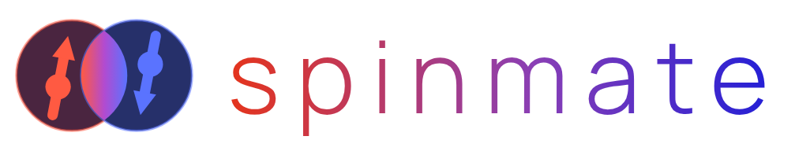
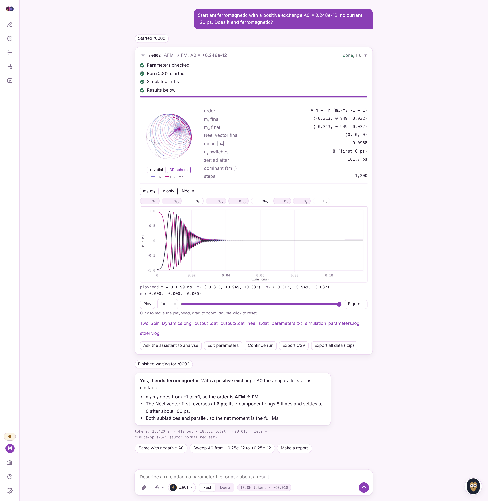
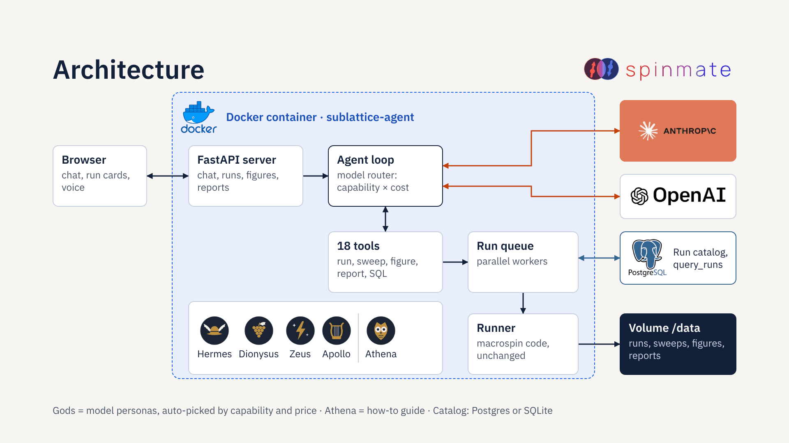

<picture>
  <source media="(prefers-color-scheme: dark)" srcset="docs/logo-dark.png">
  
</picture>

# SpinMate

SpinMate is a web interface for a two-sublattice macrospin simulator. You describe a run in plain language, or attach a parameter file, and
the selected Claude or OpenAI model checks the input with the simulator's own parser, starts the run, follows it and explains the
result from the actual magnetization curves.



The physics code in `macrospin/` is the original code and has not been modified. The repository is
named `sublattice-agent`.

## Contents

- [Quick start](#quick-start)
- [Desktop app for Windows](#desktop-app-for-windows)
- [Using the app](#using-the-app)
- [Simple scenarios to try](#simple-scenarios-to-try)
- [Continuing a run](#continuing-a-run)
- [Run catalog (Postgres)](#run-catalog-postgres)
- [Parameter files](#parameter-files)
- [Behaviour of the original code](#behaviour-of-the-original-code)
- [Configuration](#configuration)
- [Behind a corporate proxy](#behind-a-corporate-proxy)
- [How it works](#how-it-works)
- [Development](#development)
- [Security](#security)
- [License](#license)

## Quick start

You need Docker and at least one API key: Anthropic (console.anthropic.com) or OpenAI (platform.openai.com).

```bash
cp .env.example .env          # put a key in ANTHROPIC_API_KEY and/or OPENAI_API_KEY
docker compose up --build
```

Open http://localhost:8421. The host port can be changed with `HOST_PORT` in `.env`. The app listens only
on this computer (`BIND_ADDRESS=127.0.0.1`); see [Security](#security) before sharing it.

If you leave `ANTHROPIC_API_KEY` empty you can paste the key in the settings of the page instead. It is
kept in that browser tab only and sent to your own server with each message.

Results are stored in the `sublattice-data` Docker volume. To keep them in a folder on disk, replace the
volume line in `docker-compose.yml` with `- ./workspace:/data`.

Without Docker:

```bash
python -m venv .venv && source .venv/bin/activate
pip install -r requirements.txt
export ANTHROPIC_API_KEY=sk-ant-...
uvicorn app.server:app --port 8000
```

## Desktop app for Windows

No Docker or Python needed. Download **SpinMate-windows.zip** from the
[Releases](../../releases) page, unzip it, open the `SpinMate` folder and double-click `SpinMate.exe`.
A small window shows the address and the browser opens on the app; close the window to stop SpinMate.

- Windows may warn the first time because the app is not signed: **More info**, then **Run anyway**.
- API keys: paste them in Settings, or write them in `%LOCALAPPDATA%\SpinMate\.env` and restart.
- Runs are stored in `%LOCALAPPDATA%\SpinMate\data`; the run catalog is SQLite (`catalog.db` in the
  same folder) instead of Postgres, and the assistant queries it the same way.

To publish a new version, push a tag: `git tag v1.0 && git push origin v1.0`. The workflow
`.github/workflows/windows-app.yml` builds the exe on Windows, runs a self-test (one real simulation and a
catalog query) and attaches the zip to the release. To build it yourself on Windows:

```bat
pip install -r requirements.txt pyinstaller==6.21.0
pyinstaller desktop/spinmate.spec --noconfirm
dist\SpinMate\SpinMate.exe --selftest
```

## Using the app

**Chat.** The centre of the page is the chat. Type what you want to run, or attach a `.txt` parameter file
with the paperclip (drag and drop also works). Under the message box you choose the model and the mode:

- **Fast** uses the default parameters, changes only what you name and gives a short answer.
- **Deep** works from the full parameter set or your txt file, mentions the caveats that apply and gives a
  quantitative explanation.

### Models and the guide

Under the message box you choose one of four gods. Each is a level of model, not a fixed model: the
model behind it is picked from the Claude and OpenAI keys you have.

<table>
<tr><th></th><th>Persona</th><th>Best for</th><th>Typical models</th></tr>
<tr><td></td><td><b>Hermes</b><br>quick and economical</td>
<td>Single runs, the presets, short answers in Fast mode</td><td>Claude Haiku, GPT nano / mini</td></tr>
<tr><td></td><td><b>Dionysus</b><br>balanced (default)</td>
<td>Everyday runs with a clear explanation, sweeps and comparisons</td><td>Claude Sonnet, GPT-5.x</td></tr>
<tr><td></td><td><b>Zeus</b><br>deep and most capable</td>
<td>Deep mode, goal searches over several sweeps, careful reading of curves, reports</td><td>Claude Opus, OpenAI o-series</td></tr>
<tr><td></td><td><b>Apollo</b><br>specialised and new</td>
<td>Trying new or special models as they appear</td><td>Claude Fable / Mythos and other new models</td></tr>
<tr><td></td><td><b>Athena</b><br>the guide</td>
<td>How to use the app: where results are, what Fast and Deep do, what a tool does</td><td>The selected provider, with built-in answers offline</td></tr>
</table>

**How the model is chosen.** On *Auto* (the default), every request is scored over all models of the chosen
god from both providers: `capability + bonus for the god's strongest model − price weight × cost`, where the
price weight depends on the god (Hermes cares most about price, Zeus least) and shrinks when the request is
demanding (Deep mode, sweeps, comparisons, reports, long messages). So the strongest model wins unless a
cheaper one is clearly enough. There is no fixed provider order; if a call fails, the next model by the same
score is used. Pro models are used only when you pin them. Each answer shows the model, the reason and the
cost in €. To always use one model for a god, open Settings and pick it under *Model behind each god*.
The logic is in `app/router.py`, the prices in `app/pricing.py`.

The temple icon in the left bar opens *Model gods*, a comparison of the four levels with their speed and
depth and the model each would use now. The god logos are read from `web/gods/`; until a file exists the
god shows a coloured badge with its initial.

The app works without the assistant: Run setup runs a simulation directly and only the chat needs the API.

**Athena.** The owl in the bottom right corner (named after the Greek goddess of wisdom) only explains how
to use the app. It asks for your name the first time; if the provider cannot be reached it answers from a
built-in list.

**Account.** There is no password: you log in by typing your name when Athena asks for it. The round button
with your initial in the left bar shows who is signed in and lets you log out. Every name keeps its own
chat history and default parameters in the browser.

**Settings** (gear in the left bar): colour theme (Light, Dark, Spin), Anthropic API key and OpenAI API key.

By default a run is deterministic: temperature 0 and no current. See the note on `SOT_DC_Amp` below.

## Simple scenarios to try

All of these use `--t=2e-9`, no current and T = 0. The default initial state is antiferromagnetic
(m1 close to -m2, Néel vector along -z). Each one was run with the real solver.

| Scenario | Parameters | Result |
|---|---|---|
| AFM to FM (default) | `--A0=0.248e-12` | m1·m2 goes from -1 to +1 in about 50 ps |
| AFM to AFM | `--A0=-0.248e-12` | stays antiparallel |
| FM to AFM | `--A0=-0.248e-12 --m1=0.25,0,0.968 --m2=0.35,0,0.937` | becomes antiparallel in about 20 ps |
| FM to FM | `--A0=0.248e-12 --m1=0.25,0,0.968 --m2=0.35,0,0.937` | stays parallel |
| FeRh heating | `--A0=0.248e-12 --flagTempVarying --Temp=60 --Fr=0.25e9` | AFM below about 375 K, FM above |

The first four are not phase transitions in the thermodynamic sense: the exchange sign decides which
alignment is the ground state, and the start state relaxes towards it. The FeRh case is driven by
temperature through the model's own switching point.

The `examples/` folder has a file for each scenario, plus a few driven cases:

| File | Content |
|---|---|
| `afm_to_fm_transition.txt`, `afm_stable_default.txt` | AFM to FM, AFM to AFM |
| `fm_to_afm.txt`, `fm_to_fm.txt` | FM starts |
| `ferh_heating_afm_to_fm.txt`, `ferh_temperature_cycle.txt` | FeRh heating, FeRh temperature cycle |
| `neel_minus_z_no_current.txt`, `neel_plus_z_no_current.txt` | Néel vector starting along -z or +z |
| `sot_switching.txt`, `ac_drive_25GHz.txt`, `chirp_pulse.txt` | driven dynamics |

## Continuing a run

Ask "run 0-2 ns, then continue 2 ns from the last state and show me one plot", or press **Continue run**
on a finished card. `continue_run` starts a new run from the final m1, m2 (full precision) and keeps the
clock running: the solver gets `t0 + t_offset`, so AC fields, A0(t), Ku(t), the chirp and the FeRh
temperature cycle do not restart their phase. **Combine chain** (`combine_runs`) joins the segments into
one run with one trajectory, plot, CSV and summary; segment joins are dotted lines on the plot.
A FeRh run of 0-2 ns + 2-4 ns matches a single 4 ns run to about 1e-14. With thermal noise (`flag0`)
the random sequence differs from one long run, and `--gaussian` values are drawn again per segment.

## Run catalog (Postgres)

`docker compose up` also starts Postgres. Every run and sweep gets a row in the catalog when it starts and
is updated when it finishes; runs made before the catalog existed are added at startup. Trajectories stay in
the run folders, the catalog holds the parameters (all of them, as JSON), the summary and the links between
runs (`parent_run`, sweeps, combined chains).

Ask questions across runs in the chat, for example "a table of all finished runs with A0 > 0 and the time of
the first switch" or "which FeRh runs ended FM". The assistant writes one SQL query (`query_runs`), the
result appears as a table with **Export CSV**, and the SQL is shown under it. Queries are read-only: one
`SELECT` per call, in a read-only transaction, with a time limit (`QUERY_TIMEOUT_MS`) and at most 500 rows.

To look at the data yourself:

```bash
docker compose exec postgres psql -U spinmate -c "select run_id, params->>'A0' as a0, order_final from runs order by run_id"
```

Without a database (for example when running with plain `uvicorn`) the catalog is off and the assistant
falls back to reading runs one by one.

## Parameter files

The format is that of `main.py --input-file`: command-line options, one or several per line. Lines starting
with `#` are comments.

```text
# 5 ns of SOT-driven dynamics
--t=5e-9
--SOT_DC_Amp=20e6
--SOT_pol=0,1,0
--flag0 --Temp=300
```

The full list of parameters with units is in `app/prompts.py`. A sweep ("sweep Fr from 10 to 40 GHz in
5 GHz steps") starts one run per value, as the original `prepare.py`, `run_sim.py` and `avg_neel.py` do.

Each run has its own folder with the original outputs (`output1.dat`, `output2.dat`,
`Two_Spin_Dynamics.png`, logs) and two additions: `neel_z.dat` and `summary.json`. The summary holds the
final m1, m2 and Néel vector, mean |nz|, the number of nz sign changes, the dominant oscillation
frequency and the order (AFM, FM or canted) at the start and at the end.

## Behaviour of the original code

The assistant knows about these and mentions them when they matter.

- `flag5` (SOT) is always on, and the solver's default current is 30e6 A/cm². This app applies
  `--SOT_DC_Amp=0` unless the file sets a current, so that default runs have none.
- A positive `A0` is ferromagnetic coupling and a negative one is antiferromagnetic. With
  `flagTempVarying` the sign is flipped below 370 K, so use a positive `A0` there if you want AFM at low
  temperature, as in FeRh.
- `Temp` is both the noise temperature (`flag0`) and the amplitude of the temperature cycle
  (`flagTempVarying`).
- The thermal field direction comes from `np.random.rand(3)`, so it always lies in the +x+y+z octant and
  has a non-zero mean.
- `H_Amp` is added to the DC field amplitude before the `flag3` branch. Keep `Hex_AC` orthogonal to
  `Hex_DC`.
- The chirp current is not multiplied by `SHE_angle`, unlike the SOT current.
- `p`, `T` and `gamma` are parsed but not used. `RK4` exists but the solver uses `Heun`.
- The defaults in `conf.py` (Ms, Ku, damping, SHE angle) are the AFM-PUF values, not FeRh.

## Configuration

Set these in `.env`.

| Variable | Default | Meaning |
|---|---|---|
| `ANTHROPIC_API_KEY` | empty | server-side Anthropic key; otherwise paste it in Settings |
| `OPENAI_API_KEY` | empty | server-side OpenAI key; otherwise paste it in Settings |
| `CLAUDE_MODEL` | `claude-sonnet-5` | default Claude model |
| `CLAUDE_MODELS` | built-in list | fallback Claude model list |
| `OPENAI_MODEL` | `gpt-4.1` | default OpenAI model |
| `OPENAI_MODELS` | built-in list | fallback OpenAI model list |
| `HOST_PORT` | `8421` | port on your machine |
| `BIND_ADDRESS` | `127.0.0.1` | who can open the app; `0.0.0.0` = your whole network |
| `MAX_PARALLEL` | CPU cores - 1 | simultaneous runs |
| `MAX_SWEEP_RUNS` | `400` | largest sweep |
| `TOKEN_BUDGET` | `0` (off) | token limit for the assistant per server session |
| `AGENT_MAX_STEPS` | `24` | tool steps the assistant may take for one message |
| `WORKSPACE` | `/data` in Docker | where runs, sweeps and files are stored |
| `SSL_CERT_FILE` | system bundle | CA bundle used for HTTPS, see below |
| `POSTGRES_PASSWORD` | `spinmate` | password of the bundled catalog database (not exposed outside Docker) |
| `DATABASE_URL` | bundled Postgres | catalog connection; set it empty to switch the catalog off |
| `QUERY_TIMEOUT_MS` | `5000` | longest time one catalog query may run |
| `CONFIRM_MINUTES` | `10` | runs or sweeps estimated above this wall time wait for the Run it button |
| `CONFIRM_RUNS` | `40` | sweeps with more runs than this wait for the Run it button |
| `EUR_PER_USD` | daily ECB rate | fixed exchange rate for the cost estimate; empty = the ECB reference rate, refreshed daily |
| `PRICES_JSON` | built-in table | token prices, `{"model-prefix": [input, output, cache write, cache read]}` in USD per million |

One Heun step takes roughly 0.6 to 1 ms on one core, so the default 10 ns (100 000 steps) takes one to two
minutes. The runtime estimate is recalibrated from finished runs.

## Behind a corporate proxy

If the container cannot reach `api.anthropic.com` you will see one of two messages in the chat:

- `CERTIFICATE_VERIFY_FAILED`: the network re-signs HTTPS traffic with a company certificate that the
  container does not know. Put the CA bundle in `certs/` and point `SSL_CERT_FILE` at it:

  ```bash
  mkdir -p certs
  cp /etc/ssl/certs/ca-certificates.crt certs/ca-bundle.crt     # a host that already trusts the CA
  echo 'SSL_CERT_FILE=/certs/ca-bundle.crt' >> .env
  docker compose up --build -d
  ```

  The `certs/` folder is mounted read-only and ignored by git.

- "The network returned a web page instead of the Claude/OpenAI API": a gateway or acceptable-use page is
  answering in place of the API. Open the address in a browser or ask your network team to allow it.
  The simulator itself and Run setup keep working in the meantime.

## How it works



```
browser (web/index.html)
   |  conversation kept in the page, sent every turn, answer streamed back as events
   v
FastAPI (app/server.py) --> provider-neutral tool loop (Claude or OpenAI; app/agent.py, app/tools.py)
   |                                   model picked per request by capability and price (app/router.py)
   |                                   |  validate, start, sweep, get_run, cancel
   v                                   v
run queue (app/simulations.py) --> python -m app.runner   (one process per run)
   |                                   imports macrospin/main.py unchanged
   v
run catalog (app/catalog.py) --> Postgres: runs and sweeps, read-only SQL for query_runs
```

`app/runner.py` wraps the original code without changing its equations. It counts Heun steps for the
progress bar, silences the per-step print of the temperature branch, adds a font fallback and writes the
summary. Parameter files are parsed with the original `importdata.py`. `app/guide.py` backs Athena, the guide.

## Prompt evaluation

`evals/` runs a fixed set of requests (`evals/cases.py`: the starter scenarios, a 100 ps run, FeRh in Deep mode,
SOT rotation, a unit slip, a continuation, a goal search, two catalog questions, a parameter question and a
two-message greeting check) through the real agent and real simulations, and checks the tools used, the final
order, the answer length and what the answer says. It uses a temporary workspace, so your runs are not touched.

```bash
docker compose exec -e ANTHROPIC_API_KEY=sk-... sublattice-agent python -m evals.run_eval --label v2
docker compose exec -e ANTHROPIC_API_KEY=sk-... sublattice-agent python -m evals.run_eval --label v1 --prompt v1
docker compose exec sublattice-agent python -m evals.run_eval --compare evals/results/v1.json evals/results/v2.json
docker compose cp sublattice-agent:/app/evals/results ./evals/
```

`--prompt v1` uses the previous prompt (`evals/prompt_v1.py`), `--cases a,b` runs only some cases and
`--model` picks the model. Each report (`evals/results/<label>.md`) lists, per case, the checks, model calls,
tokens, answer lines, the tool sequence and the answer.

## Development

```bash
pip install -r requirements-dev.txt
pytest -q
```

```
app/               server, agent loop, tools, run manager, runner, prompts, guide
macrospin/         original simulation code, unchanged
original_scripts/  original batch scripts (prepare, run_sim, avg_neel, neel_vector_generate)
web/index.html     the whole interface
examples/          parameter files
tests/             smoke tests
```

The server has no login. It is meant for local use; do not expose the port to the internet, since anyone
who can reach it can start simulations and use the server-side API keys.

## Security

SpinMate is meant to run on your own computer.

- **Local only by default.** Docker publishes the app on `127.0.0.1`. There is no password (the name you
  give Athena is not a login), so anyone who can reach the page can run simulations and spend your API
  key. Set `BIND_ADDRESS=0.0.0.0` only behind a reverse proxy with real authentication.
- **Limit the cost.** Set `TOKEN_BUDGET` in `.env` and a monthly spend limit in the Anthropic and OpenAI
  consoles. Use a separate API key for SpinMate so you can revoke it on its own.
- **Change `POSTGRES_PASSWORD`.** The database is not exposed outside Docker, but the default is public.
- **Keys** stay in `.env` (ignored by git) or in the browser tab where you paste them.
- The agent can only read the run catalog (read-only SQL with a timeout) and only start runs through the
  solver's own parameter parser; uploads are limited to 200 kB of text.

## License

SpinMate is free and open source under the [MIT License](LICENSE): anyone may use, copy, modify and
share it, for research, teaching or commercial work, as long as the copyright notice is kept. It comes
without warranty. If you use it in published work, a mention of SpinMate is appreciated.

The API keys you add are yours; calls to Anthropic or OpenAI are billed to your own account.
