<picture>
  <source media="(prefers-color-scheme: dark)" srcset="docs/logo-dark.png">
  
</picture>

# SpinMate

**An AI agent for spintronics simulation.** Describe the setup in plain language or provide a parameter
file. SpinMate validates the input with the solver's own parser, runs two-sublattice macrospin simulations, and
explains the results from the actual magnetization dynamics, with figures and reports ready to share.

<picture>
  <source media="(prefers-color-scheme: dark)" srcset="docs/screenshots/hero-dark.png">
  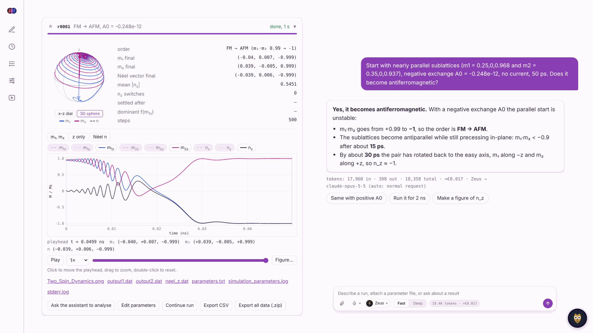
</picture>

## Contents

- [Quick start](#quick-start)
- [Desktop app for Windows](#desktop-app-for-windows)
- [Using the app](#using-the-app)
- [Simple scenarios to try](#simple-scenarios-to-try)
- [Continuing a run](#continuing-a-run)
- [Run catalog (Postgres)](#run-catalog-postgres)
- [Parameter files](#parameter-files)
- [Behaviour of the original code](#behaviour-of-the-original-code)
- [Configuration](#configuration)
- [Behind a corporate proxy](#behind-a-corporate-proxy)
- [How it works](#how-it-works)
- [Version 2.0 (in development)](#version-20-in-development)
- [Admin page](#admin-page)
- [Prompt evaluation](#prompt-evaluation)
- [Development](#development)
- [Security](#security)
- [Contact](#contact)
- [License](#license)

## Quick start

You need Docker and at least one API key: Anthropic (console.anthropic.com), OpenAI (platform.openai.com) or
Gemini ([aistudio.google.com/api-keys](https://aistudio.google.com/api-keys)).

```bash
cp .env.example .env          # put a key in ANTHROPIC_API_KEY, OPENAI_API_KEY and/or GEMINI_API_KEY
docker compose up --build
```

Open http://localhost:8421. The host port can be changed with `HOST_PORT` in `.env`. The app listens only
on this computer (`BIND_ADDRESS=127.0.0.1`); see [Security](#security) before sharing it.

If you leave the keys empty you can paste them in the settings of the page instead. They are kept in that
browser tab only and sent to your own server with each message; under each key the page shows whether it
works and how many models it can use. One working key is enough: SpinMate uses only the providers whose key
works, and the × in a key field deletes that key from the tab.

Results are stored in the `sublattice-data` Docker volume. To keep them in a folder on disk, replace the
volume line in `docker-compose.yml` with `- ./workspace:/data`.

Without Docker:

```bash
python -m venv .venv && source .venv/bin/activate
pip install -r requirements.txt
export ANTHROPIC_API_KEY=sk-ant-...
uvicorn app.server:app --port 8000
```

## Desktop app for Windows

No Docker or Python needed. Download **SpinMate-windows.zip** from the
[Releases](../../releases) page, unzip it, open the `SpinMate` folder and double-click `SpinMate.exe`.
A small window shows the address and the browser opens on the app; close the window to stop SpinMate.

- Windows may warn the first time because the app is not signed: **More info**, then **Run anyway**.
- API keys: paste them in Settings, or write them in `%LOCALAPPDATA%\SpinMate\.env` and restart.
- Runs are stored in `%LOCALAPPDATA%\SpinMate\data`; the run catalog is SQLite (`catalog.db` in the
  same folder) instead of Postgres, and the assistant queries it the same way.

To publish a new version, push a tag: `git tag v1.0 && git push origin v1.0`. The workflow
`.github/workflows/windows-app.yml` builds the exe on Windows, runs a self-test (one real simulation and a
catalog query) and attaches the zip to the release. To build it yourself on Windows:

```bat
pip install -r requirements.txt pyinstaller==6.21.0
pyinstaller desktop/spinmate.spec --noconfirm
dist\SpinMate\SpinMate.exe --selftest
```

## Using the app

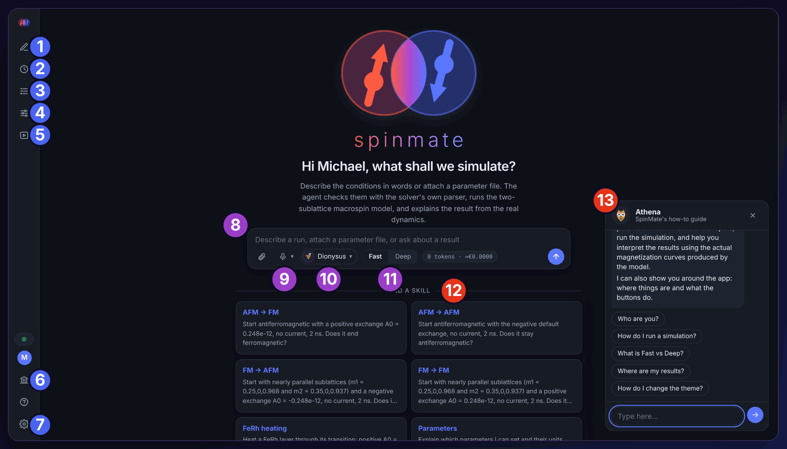

| # | Where | What it does |
|---|---|---|
| 1 | Left bar | **New conversation** (Ctrl+K). Starts an empty chat; the previous one stays in the history. |
| 2 | Left bar | **Conversation history.** Your earlier chats, kept per name. |
| 3 | Left bar | **Runs panel** (Ctrl+/). Every run and sweep: search, filter, star, compare, plot or report (see [Run catalog](#run-catalog-postgres)). |
| 4 | Left bar | **Default parameters.** The values Fast mode starts from, kept per name. |
| 5 | Left bar | **Run setup.** Run a preset or your `.txt` file directly, without the assistant or an API key. Its **Engine** menu picks macrospin, mm2d (2D: skyrmions, spin waves) or mm3d (3D: hopfions), and mumax3 when installed. |
| 6 | Left bar | **Physics validation.** Green when the solver passes all its analytic checks; click for the report and the phase diagram (see [Physics validation](#physics-validation)). |
| 7 | Left bar | **Connect to Claude.** The commands that add SpinMate to Claude Code, Claude Desktop or any MCP agent, with copy buttons. |
| 8 | Left bar | **Model gods** (temple) and the **tools guide** (?): what each model level and each tool does. |
| 9 | Left bar | **Settings.** Language, colour theme (Light, Dark, Spin), the Anthropic, OpenAI and Gemini API keys with a check of each, and the model behind each god. |
| 10 | Message box | **Ask** in plain language, or attach a `.txt` parameter file with the paperclip (drag and drop works too). The chart icon next to it opens a **sweep or threshold search form**: parameter in convenient units, range, steps, duration; it writes the request with SI values and warns about unusual numbers. |
| 11 | Message box | **Voice input.** Dictate the request; the arrow next to it picks the microphone. |
| 12 | Message box | **Persona**: the model level (Hermes, Dionysus, Zeus, Apollo), see [Models and the guide](#models-and-the-guide). |
| 13 | Message box | **Fast or Deep**, and the tokens and cost in € of the conversation. Click the counter for **usage and cost** per day and per provider (Claude, OpenAI, Gemini). |
| 14 | Start here | **Find a skill.** Ready questions: FM → AFM, FM → FM, Néel and Bloch skyrmions, a hopfion, skyrmion motion, a synthetic-AFM skyrmion, spin waves and FeRh heating; click one to ask it. |
| 15 | Start here | **Athena**, the how-to guide. She also gives you the user guide and the presentation (PDF). |

**Chat.** The centre of the page is the chat. Type what you want to run, or attach a `.txt` parameter file
with the paperclip (drag and drop also works). Under the message box you choose the model and the mode:

- **Fast** uses the default parameters, changes only what you name and gives a short answer.
- **Deep** works from the full parameter set or your txt file, mentions the caveats that apply and gives a
  quantitative explanation.

### Models and the guide

Under the message box you choose one of four gods. Each is a level of model, not a fixed model: the
model behind it is picked from the Claude, OpenAI and Gemini keys you have.

<table>
<tr><th></th><th>Persona</th><th>Best for</th><th>Typical models</th></tr>
<tr><td></td><td><b>Hermes</b><br>quick and economical</td>
<td>Single runs, the presets, short answers in Fast mode</td><td>Claude Haiku, GPT nano / mini, Gemini Flash-Lite</td></tr>
<tr><td></td><td><b>Dionysus</b><br>balanced (default)</td>
<td>Everyday runs with a clear explanation, sweeps and comparisons</td><td>Claude Sonnet, GPT-5.x, Gemini Flash</td></tr>
<tr><td></td><td><b>Zeus</b><br>deep and most capable</td>
<td>Deep mode, goal searches over several sweeps, careful reading of curves, reports</td><td>Claude Opus, OpenAI o-series, Gemini Pro</td></tr>
<tr><td></td><td><b>Apollo</b><br>specialised and new</td>
<td>Trying new or special models as they appear</td><td>Claude Fable / Mythos, other Gemini lines and new models</td></tr>
<tr><td></td><td><b>Athena</b><br>the guide</td>
<td>How to use the app: where results are, what Fast and Deep do, what a tool does</td><td>The selected provider, with built-in answers offline</td></tr>
</table>

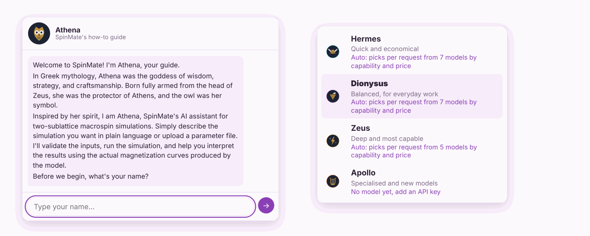

**How the model is chosen.** On *Auto* (the default), every request is scored over all models of the chosen
god from every provider you have a key for (Anthropic, OpenAI, Gemini): `capability + bonus for the god's strongest model − price weight × cost`, where the
price weight depends on the god (Hermes cares most about price, Zeus least) and shrinks when the request is
demanding (Deep mode, sweeps, comparisons, reports, long messages). So the strongest model wins unless a
cheaper one is clearly enough. There is no fixed provider order; if a call fails, the next model by the same
score is used. Pro models are used only when you pin them. Each answer shows the model, the reason and the
cost in €. To always use one model for a god, open Settings and pick it under *Model behind each god*.
The logic is in `app/router.py`, the prices in `app/pricing.py`.

Every answer ends with a line with its tokens, its cost and the model, marked **Claude**, **OpenAI** or
**Gemini** in the colours of the SpinMate logo.

**Keyboard shortcuts.** Ctrl+K new conversation, Ctrl+/ the Runs panel, Enter send, Shift+Enter new line, Esc
closes a window (Cmd instead of Ctrl on a Mac).

**Ask another god.** Under every answer, *Ask another god* sends the same question to another model level and
shows both answers side by side, for example Dionysus next to Zeus, or Claude next to Gemini.

The temple icon in the left bar opens *Model gods*, a comparison of the four levels with their speed and
depth and the model each would use now. The god logos are read from `web/gods/`; until a file exists the
god shows a coloured badge with its initial.

The app works without the assistant: Run setup runs a simulation directly and only the chat needs the API.

**Athena.** The owl in the bottom right corner (named after the Greek goddess of wisdom) only explains how
to use the app. Ask her for the user guide or the presentation (in any of the six languages) and she gives you both PDFs
to open or download. The first time it asks for your name and, optionally, your email to create an account: you
then receive a welcome email with the logo, a greeting with your name and the PDF user guide
([`web/spinmate-guide.pdf`](web/spinmate-guide.pdf), source in `docs/guide/`). Set `SMTP_*` in `.env` to send it;
without a mail server it is saved to `workspace/outbox`. If the provider cannot be reached Athena answers from a
built-in list.

**Account.** There is no password: you log in by typing your name when Athena asks for it. The round button
with your initial in the left bar shows who is signed in and lets you log out. Every name keeps its own
chat history and default parameters in the browser.

**Settings** (gear in the left bar): language, colour theme (Light, Dark, Spin), Anthropic, OpenAI and Gemini API keys.

**Language.** English (US or UK), Greek, Spanish, German or Italian. It changes the buttons, menus and
Athena, and the assistant answers in that language. Chosen once per browser; the first time it follows the
browser's language.

By default a run is deterministic: temperature 0 and no current. See the note on `SOT_DC_Amp` below.

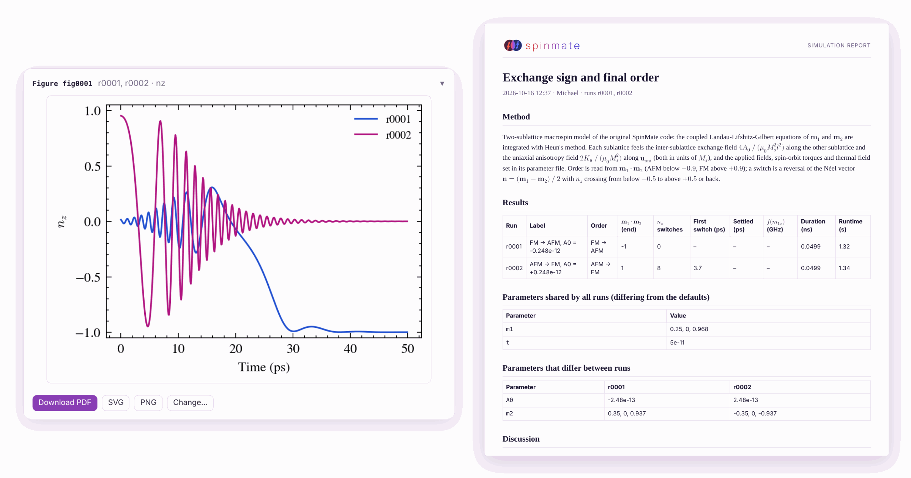

## Simple scenarios to try

All of these use `--t=2e-9`, no current and T = 0. The default initial state is antiferromagnetic
(m1 close to -m2, Néel vector along -z). Each one was run with the real solver.

| Scenario | Parameters | Result |
|---|---|---|
| AFM to FM (default) | `--A0=0.248e-12` | m1·m2 goes from -1 to +1 in about 50 ps |
| AFM to AFM | `--A0=-0.248e-12` | stays antiparallel |
| FM to AFM | `--A0=-0.248e-12 --m1=0.25,0,0.968 --m2=0.35,0,0.937` | becomes antiparallel in about 20 ps |
| FM to FM | `--A0=0.248e-12 --m1=0.25,0,0.968 --m2=0.35,0,0.937` | stays parallel |
| FeRh heating | `--A0=0.248e-12 --flagTempVarying --Temp=60 --Fr=0.25e9` | AFM below about 375 K, FM above |

The first four are not phase transitions in the thermodynamic sense: the exchange sign decides which
alignment is the ground state, and the start state relaxes towards it. The FeRh case is driven by
temperature through the model's own switching point.

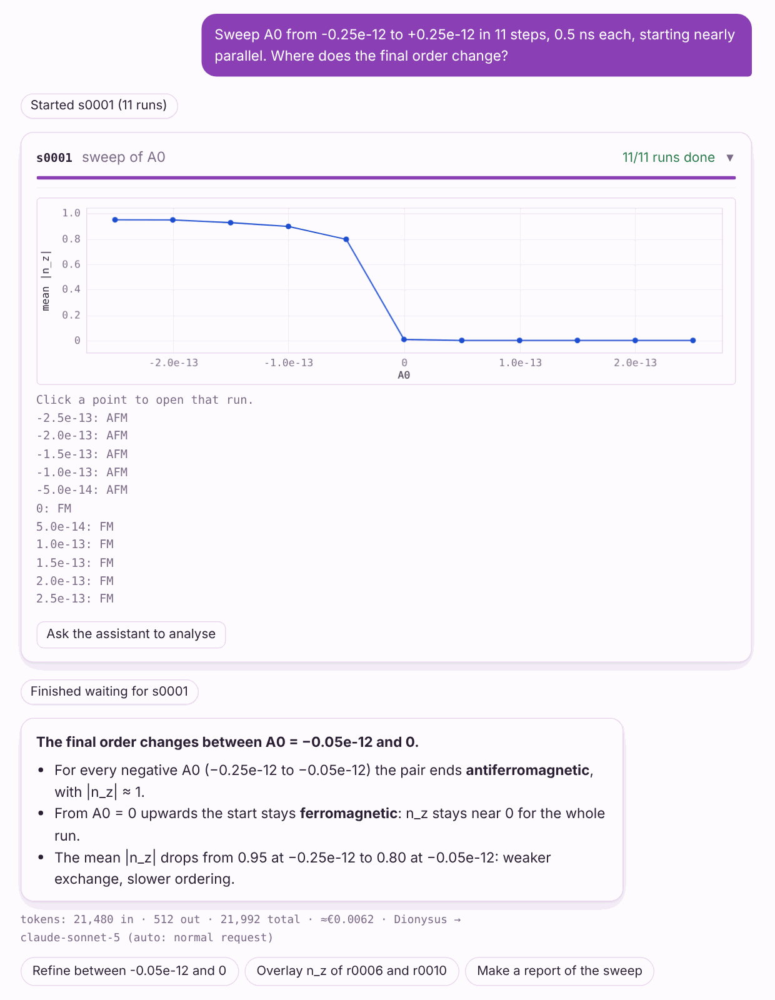

The `examples/` folder has a file for each scenario, plus a few driven cases:

| File | Content |
|---|---|
| `afm_to_fm_transition.txt`, `afm_stable_default.txt` | AFM to FM, AFM to AFM |
| `fm_to_afm.txt`, `fm_to_fm.txt` | FM starts |
| `ferh_heating_afm_to_fm.txt`, `ferh_temperature_cycle.txt` | FeRh heating, FeRh temperature cycle |
| `neel_minus_z_no_current.txt`, `neel_plus_z_no_current.txt` | Néel vector starting along -z or +z |
| `sot_switching.txt`, `ac_drive_25GHz.txt`, `chirp_pulse.txt` | driven dynamics |

## Continuing a run

Ask "run 0-2 ns, then continue 2 ns from the last state and show me one plot", or press **Continue run**
on a finished card. `continue_run` starts a new run from the final m1, m2 (full precision) and keeps the
clock running: the solver gets `t0 + t_offset`, so AC fields, A0(t), Ku(t), the chirp and the FeRh
temperature cycle do not restart their phase. **Combine chain** (`combine_runs`) joins the segments into
one run with one trajectory, plot, CSV and summary; segment joins are dotted lines on the plot.
A FeRh run of 0-2 ns + 2-4 ns matches a single 4 ns run to about 1e-14. With thermal noise (`flag0`)
the random sequence differs from one long run, and `--gaussian` values are drawn again per segment.

## Run catalog (Postgres)

`docker compose up` also starts Postgres. Every run and sweep gets a row in the catalog when it starts and
is updated when it finishes; runs made before the catalog existed are added at startup. Trajectories stay in
the run folders, the catalog holds the parameters (all of them, as JSON), the summary and the links between
runs (`parent_run`, sweeps, combined chains).

Ask questions across runs in the chat, for example "a table of all finished runs with A0 > 0 and the time of
the first switch" or "which FeRh runs ended FM". The assistant writes one SQL query (`query_runs`), the
result appears as a table with **Export CSV**, and the SQL is shown under it. Queries are read-only: one
`SELECT` per call, in a read-only transaction, with a time limit (`QUERY_TIMEOUT_MS`) and at most 500 rows.

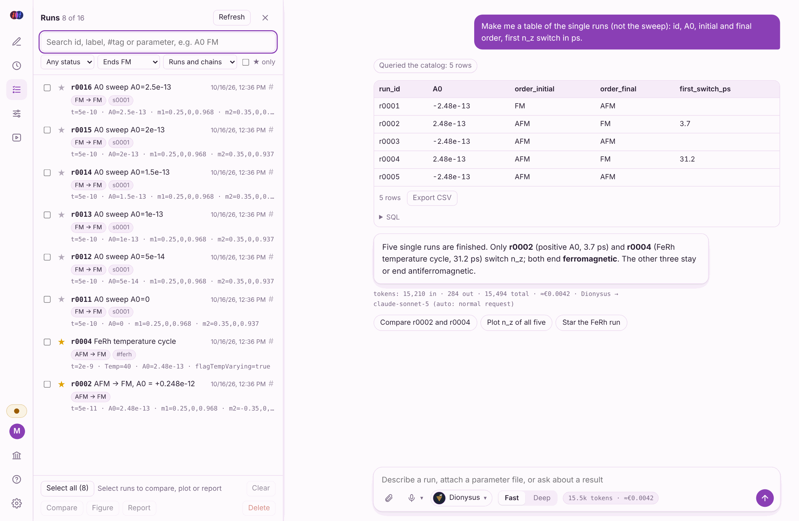

To look at the data yourself:

```bash
docker compose exec postgres psql -U spinmate -c "select run_id, params->>'A0' as a0, order_final from runs order by run_id"
```

Without a database (for example when running with plain `uvicorn`) the catalog is off and the assistant
falls back to reading runs one by one.

## Parameter files

The format is that of `main.py --input-file`: command-line options, one or several per line. Lines starting
with `#` are comments.

```text
# 5 ns of SOT-driven dynamics
--t=5e-9
--SOT_DC_Amp=20e6
--SOT_pol=0,1,0
--flag0 --Temp=300
```

The full list of parameters with units is in `app/prompts.py`. A sweep ("sweep Fr from 10 to 40 GHz in
5 GHz steps") starts one run per value, as the original `prepare.py`, `run_sim.py` and `avg_neel.py` do.

Each run has its own folder with the original outputs (`output1.dat`, `output2.dat`,
`Two_Spin_Dynamics.png`, logs) and two additions: `neel_z.dat` and `summary.json`. The summary holds the
final m1, m2 and Néel vector, mean |nz|, the number of nz sign changes, the dominant oscillation
frequency and the order (AFM, FM or canted) at the start and at the end.

## Behaviour of the original code

The assistant knows about these and mentions them when they matter.

- `flag5` (SOT) is always on, and the solver's default current is 30e6 A/cm². This app applies
  `--SOT_DC_Amp=0` unless the file sets a current, so that default runs have none.
- A positive `A0` is ferromagnetic coupling and a negative one is antiferromagnetic. With
  `flagTempVarying` the sign is flipped below 370 K, so use a positive `A0` there if you want AFM at low
  temperature, as in FeRh.
- `Temp` is both the noise temperature (`flag0`) and the amplitude of the temperature cycle
  (`flagTempVarying`).
- Version 2.0 fixed four issues of the original code: the thermal field is now Gaussian (it was a vector in
  the +x+y+z octant), the anisotropy is added once, the Ku(t) amplitude has the right units and `RK4` has the
  right weights. Runs at T = 0 without Ku(t) are unchanged; see [Physics validation](#physics-validation).
- `H_Amp` is added to the DC field amplitude before the `flag3` branch. Keep `Hex_AC` orthogonal to
  `Hex_DC`.
- The chirp current is not multiplied by `SHE_angle`, unlike the SOT current.
- `p`, `T` and `gamma` are parsed but not used. The solver uses `Heun`; `RK4` is optional.
- The defaults in `conf.py` (Ms, Ku, damping, SHE angle) are the AFM-PUF values, not FeRh.

## Configuration

Set these in `.env`.

| Variable | Default | Meaning |
|---|---|---|
| `ANTHROPIC_API_KEY` | empty | server-side Anthropic key; otherwise paste it in Settings |
| `OPENAI_API_KEY` | empty | server-side OpenAI key; otherwise paste it in Settings |
| `GEMINI_API_KEY` | empty | server-side Gemini key (Google AI Studio); otherwise paste it in Settings |
| `CLAUDE_MODEL` | `claude-sonnet-5` | default Claude model |
| `CLAUDE_MODELS` | built-in list | fallback Claude model list |
| `OPENAI_MODEL` | `gpt-4.1` | default OpenAI model |
| `OPENAI_MODELS` | built-in list | fallback OpenAI model list |
| `GEMINI_MODEL` | `gemini-2.5-flash` | default Gemini model |
| `GEMINI_MODELS` | built-in list | fallback Gemini model list |
| `HOST_PORT` | `8421` | port on your machine |
| `SMTP_HOST`, `SMTP_PORT`, `SMTP_USER`, `SMTP_PASSWORD`, `SMTP_FROM` | empty | mail server for the optional welcome email; empty = saved to `workspace/outbox` |
| `BIND_ADDRESS` | `127.0.0.1` | who can open the app; `0.0.0.0` = your whole network |
| `MAX_PARALLEL` | CPU cores - 1 | simultaneous runs |
| `MAX_SWEEP_RUNS` | `400` | largest sweep |
| `TOKEN_BUDGET` | `0` (off) | token limit for the assistant per server session |
| `AGENT_MAX_STEPS` | `24` | tool steps the assistant may take for one message |
| `WORKSPACE` | `/data` in Docker | where runs, sweeps and files are stored |
| `SSL_CERT_FILE` | system bundle | CA bundle used for HTTPS, see below |
| `POSTGRES_PASSWORD` | `spinmate` | password of the bundled catalog database (not exposed outside Docker) |
| `DATABASE_URL` | bundled Postgres | catalog connection; set it empty to switch the catalog off |
| `QUERY_TIMEOUT_MS` | `5000` | longest time one catalog query may run |
| `CONFIRM_MINUTES` | `10` | runs or sweeps estimated above this wall time wait for the Run it button |
| `CONFIRM_RUNS` | `40` | sweeps with more runs than this wait for the Run it button |
| `EUR_PER_USD` | daily ECB rate | fixed exchange rate for the cost estimate; empty = the ECB reference rate, refreshed daily |
| `APP_URL` | `http://localhost:8421` | address used in emails and in the links that MCP results return |
| `MAIL_RELAY` | project relay | where the welcome email is sent from; `off` saves it to `workspace/outbox` |
| `ADMIN_TOKEN` | empty (off) | turns on `/admin` and is its password |
| `ADMIN_SHEET_URL` | empty | link to the SpinMate users Sheet, shown on the admin page |
| `MUMAX3_BIN` | empty | path of the mumax3 binary, only for the optional mumax3 engine |
| `PRICES_JSON` | built-in table | token prices, `{"model-prefix": [input, output, cache write, cache read]}` in USD per million |

One Heun step takes roughly 0.6 to 1 ms on one core, so the default 10 ns (100 000 steps) takes one to two
minutes. The runtime estimate is recalibrated from finished runs.

## Behind a corporate proxy

If the container cannot reach `api.anthropic.com` you will see one of two messages in the chat:

- `CERTIFICATE_VERIFY_FAILED`: the network re-signs HTTPS traffic with a company certificate that the
  container does not know. Put the CA bundle in `certs/` and point `SSL_CERT_FILE` at it:

  ```bash
  mkdir -p certs
  cp /etc/ssl/certs/ca-certificates.crt certs/ca-bundle.crt     # a host that already trusts the CA
  echo 'SSL_CERT_FILE=/certs/ca-bundle.crt' >> .env
  docker compose up --build -d
  ```

  The `certs/` folder is mounted read-only and ignored by git.

- "The network returned a web page instead of the Claude/OpenAI/Gemini API": a gateway or acceptable-use page is
  answering in place of the API. Open the address in a browser or ask your network team to allow it.
  The simulator itself and Run setup keep working in the meantime.

## How it works

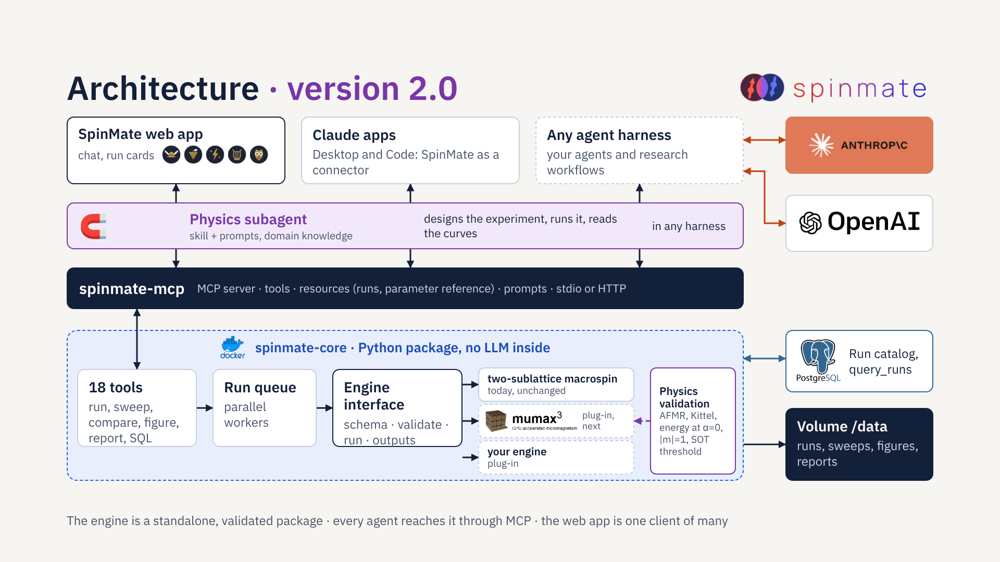

```
browser (web/index.html)                  Claude Code / Claude Desktop / any MCP agent
   |  conversation kept in the page          |
   v                                         |
FastAPI (app/server.py)                      |
   agent loop: Claude, OpenAI or Gemini (app/agent.py), model picked per request (app/router.py)
   |  calls the tools through MCP (app/mcp_client.py)
   v                                         v
spinmate-mcp (spinmate_mcp/): tools, resources, prompts, over stdio or HTTP (/mcp)
   v
spinmate-core (spinmate_core/): tools, run queue, sweeps, catalog, figures, reports, validation
   v
engine interface: macrospin, mm2d and mm3d (built in) | mumax3 or another engine (optional plug-ins)
   |  python -m spinmate_core.runner, one process per run
   v
run catalog (Postgres or SQLite): read-only SQL for query_runs
```

`spinmate_core/runner.py` wraps the original code without changing its equations. It counts Heun steps for the
progress bar, silences the per-step print of the temperature branch, adds a font fallback and writes the
summary. Parameter files are parsed with the original `importdata.py`. `app/guide.py` backs Athena, the guide.

## Version 2.0 (in development)

Version 2.0 turns SpinMate from a standalone app into a reusable scientific capability. The physics engine
becomes a Python package with no LLM inside, every agent reaches it through MCP (Model Context Protocol),
and the web app becomes one client among many.

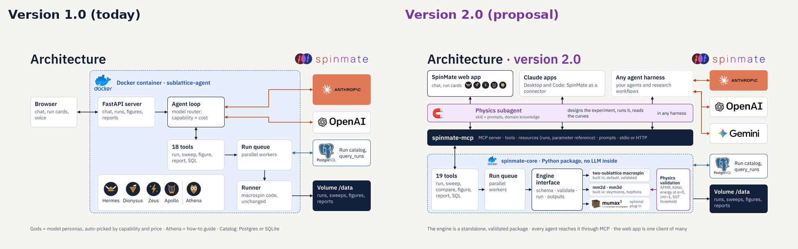

| | Version 1.0 (today) | Version 2.0 |
|---|---|---|
| Who can use it | the SpinMate web app | the web app, Claude Desktop and Claude Code, any MCP agent |
| Interface | FastAPI and one agent loop | MCP server: tools, resources, prompts, over stdio or HTTP |
| Physics knowledge | in the app's system prompt | a physics subagent (skill and prompts) usable in any harness |
| Models | Claude and OpenAI | Claude, OpenAI and Gemini |
| Engine | the macrospin code, built in | an engine interface: macrospin, mm2d and mm3d (2D and 3D micromagnetics) built in, mumax3 or any engine as an optional plug-in |
| Validation | tests of the app | a physics validation suite: AFMR and Kittel frequencies, energy at α=0, \|m\|=1, damping, AFM/FM boundary, thermal field |
| Package | one app | `spinmate-core` (no LLM), `spinmate-mcp`, the web app |

### Use SpinMate from Claude and other agents (MCP)

The first step of 2.0 is ready: SpinMate is also an MCP server. It offers the same tools as the chat
(validate, run, sweep, wait, get_run with the plot, compare, figure, report and SQL on the catalog), the
runs and the parameter reference as resources, and short instructions for the agent. Large requests return
`needs_confirmation`; the agent asks you and calls again with `confirmed=true`.

**Claude Code**, with the Docker app running (same process, same run queue as the web app):

```bash
claude mcp add --transport http spinmate http://localhost:8421/mcp
```

**Claude Desktop**, in *Settings → Developer → Edit config* (`claude_desktop_config.json`), with the Docker
app running:

```json
{
  "mcpServers": {
    "spinmate": {
      "command": "docker",
      "args": ["compose", "-f", "/path/to/Spinmate-AI-Agent/docker-compose.yml",
               "exec", "-T", "sublattice-agent", "python", "-m", "spinmate_mcp"]
    }
  }
}
```

The plug icon in the left bar of the app shows these commands for your server, with copy buttons.

This starts the server over stdio inside the container, on the same `/data`. Without Docker, run
`python -m spinmate_mcp` from the repository (stdio), or `python -m spinmate_mcp --http` for
`http://127.0.0.1:8422/mcp`. Links in the results (figures, reports) point to `APP_URL`, by default
`http://localhost:8421`.

### spinmate-core: the engine without an LLM

Parameters, runs, sweeps, the catalog, figures, reports and the tools live in `spinmate_core/`, a package
that loads no LLM library. The web app (`app/`) and the MCP server (`spinmate_mcp/`) sit on top of it. It has
its own command line:

```bash
python -m spinmate_core engines                   # the simulation engines
python -m spinmate_core validate params.txt       # check a file with the solver's own parser
python -m spinmate_core run params.txt            # run it, wait, print the summary
```

Every engine implements one interface (`spinmate_core/engines/base.py`): `parameter_schema()`, `validate()`,
`run_command()` and `outputs()`. Three engines are built in, macrospin, mm2d and mm3d, and every run records which
engine produced it. Other engines are plug-ins, installed as Python packages that register under the entry
point group `spinmate.engines`:

```toml
[project.entry-points."spinmate.engines"]
mumax3 = "spinmate_mumax3:Mumax3Engine"
```

### Physics validation

`python -m spinmate_core.validation` runs the real solver on cases with an analytic answer and writes a
report to `WORKSPACE/validation/report.html` (agents read it as `spinmate://validation`). It runs on every
pull request that changes `macrospin/` or `spinmate_core/`.

Each sublattice carries Ms/2, so the fields are μ0H_E = 4|A0|/(Ms l²) and μ0H_K = 4Ku/Ms.

| Case | Expected | Measured | Result |
|---|---|---|---|
| \|m1\| = \|m2\| = 1 | 0 | 2e-16 | pass |
| Same input, same trajectory | 0 | 0 | pass |
| Energy with α = 0, 0.5 ns | conserved | drift 1.6e-6 | pass |
| Kittel, f = γ μ0 (H_K + H) / 2π | 5.62 GHz, 27.99 GHz/T | 5.61 GHz, 28.03 GHz/T | pass |
| AFMR, f = γ μ0 √(H_K (2H_E + H_K)) / 2π | 67.3 GHz | 67.3 GHz | pass |
| Time-step convergence (AFMR) | h = 1e-13 s ≈ 2e-14 s | 0.03 % apart | pass |
| Gilbert damping, decay rate α·ω | 0.3525 /ns | 0.3524 /ns | pass |
| AFM/FM boundary \|Ku\| = 2\|A0\|/l² | stable above, unstable below | as expected at ±10 % | pass |
| Thermal field | isotropic, σ = Temp_Ampl | mean < 0.03 σ, σ within 3 % | pass |

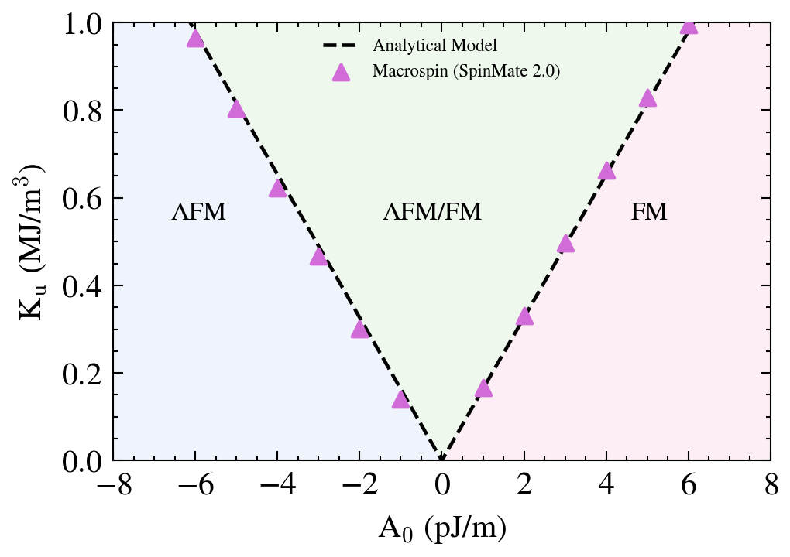

The boundary measured by bisection with the solver (12 points, `docs/validation/phase-boundary.json`) lies
on |Ku| = 2|A0|/l² within 2-6 %; the small offsets come from the finite run time and the finite starting angle.

**Fixed in version 2.0.** The first run of the suite found four issues in `macrospin/`. Runs at T = 0 without
Ku(t) give exactly the same trajectories as before (checked bit for bit on nine scenarios), and the AFM/FM
boundary is unchanged.

- **F1.** The 4 in H_K came from adding the static anisotropy twice: `ku()` returned K when `flag2` was off and
  the solver added it again along `u_ani_AC`. It broke as soon as `u_ani_AC` differs from `u_ani` or Ku(t) is on.
  Now K = 4Ku/(μ0Ms²) in one term and `ku()` returns only the AC part.
- **F4.** The Ku(t) amplitude was divided by g0·Ms² instead of μ0·Ms², 1.76e11 times too weak.
- **F2.** `RK4()` used the weight 0.166 instead of 1/6 and fed the m1 slopes into the m2 stages (Heun is the
  default integrator, so earlier runs were not affected).
- **F3.** The thermal field was Temp_Ampl times a unit vector with only positive components; it is now Gaussian
  with standard deviation Temp_Ampl per component, as `run.py` defines it. Runs with temperature change.

### The web app as an MCP client

The chat agent of the web app (`app/agent.py`) no longer imports the tools: it lists and calls them through
the MCP server, in the same process (`app/mcp_client.py`), exactly as Claude Desktop or any other agent does.
Only the Run button approves a large request; the model never sees the `confirmed` argument. The physics part
of its system prompt (how to read a run, the scales of the material) comes from `spinmate_mcp/physics.md`, the
same file as the MCP prompts and the Claude Code subagent.

### mm2d engine: SpinMate's own 2D micromagnetics (built in)

`spinmate_core/mm2d` is SpinMate's own finite-difference solver, part of the core like macrospin: NumPy on
the CPU, nothing to install, for a ferromagnetic film one cell thick. It finds skyrmions, skyrmionium and domain walls and runs LLG dynamics:

```text
--mode=relax
--texture=skyrmion
--Aex=15e-12
--Ku=0.8e6
--Msat=580e3
--D=3.5e-3
--Nx=128
--Ny=128
```

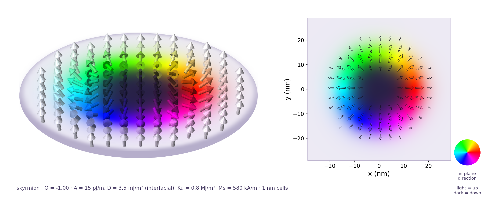
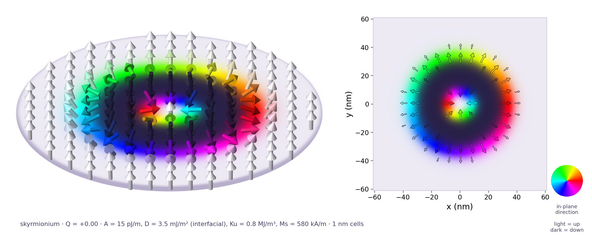

- **Physics.** Exchange, perpendicular anisotropy, interfacial (Néel) or bulk (Bloch) DMI, Zeeman and the local
  thin-film demagnetising field; periodic or free edges.
- **Modes.** `mode=relax` lowers the energy (steepest descent with Barzilai–Borwein steps) from a seed:
  `skyrmion`, `skyrmionium`, `domain_wall`, `uniform` or `random`. `mode=dynamics` relaxes first and then solves
  LLG with an adaptive Runge–Kutta (Dormand–Prince) solver, with an optional field pulse `B_pulse` for `t_pulse`.
- **Results.** The run card shows the final texture as a tilted 3D view and a top view (colour: in-plane
  direction; light = up, dark = down), with the topological charge Q, the radius or the rings and, in dynamics,
  the main frequency. `m_final.npz` keeps the full state.
- **Skyrmion motion.** With a current `j` the skyrmion moves by spin-transfer torque (`stt_P`, `stt_beta`,
  Zhang-Li) or by spin-orbit torque from a heavy metal (`theta_SH`, damping-like, σ = z × j). The card shows its
  path, the velocity, the skyrmion Hall angle and the Thiele prediction for the relaxed texture.

```text
--mode=dynamics
--texture=skyrmion
--Nx=96
--Ny=96
--alpha=0.1
--j=1e12,0,0
--theta_SH=0.1
--t=400e-12
```

<table>
<tr>
<td width="50%">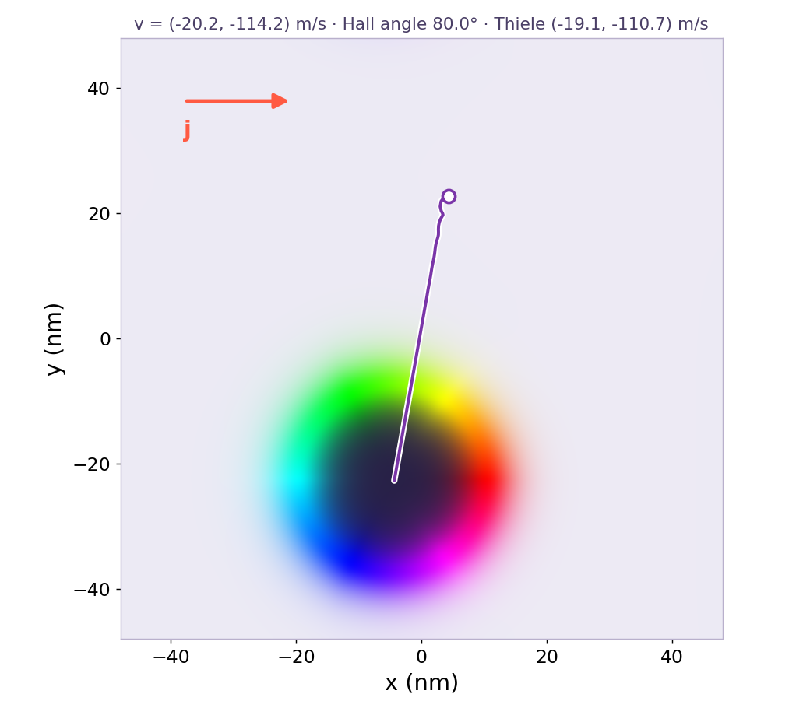</td>
<td width="50%">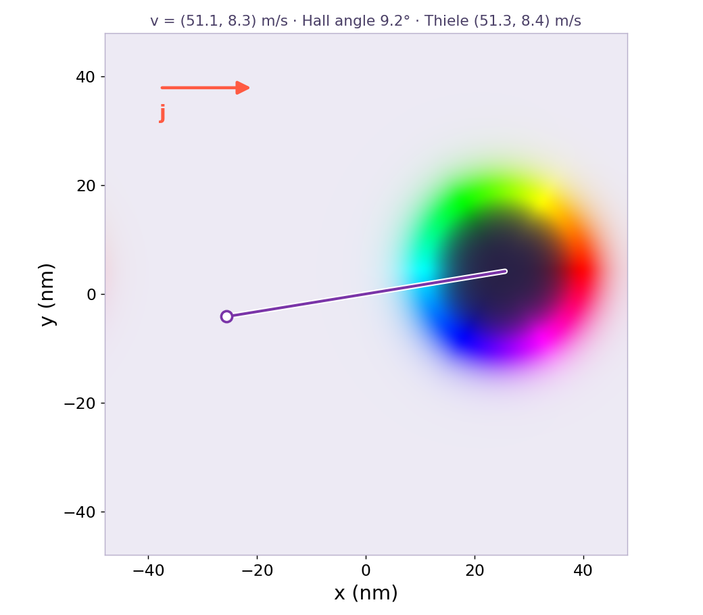</td>
</tr>
<tr><td align="center"><i>SOT, 1e12 A/m²: 116 m/s, deflected 80° (skyrmion Hall angle)</i></td><td align="center"><i>STT, u = 50 m/s, β = 2α: Hall angle 9°</i></td></tr>
</table>

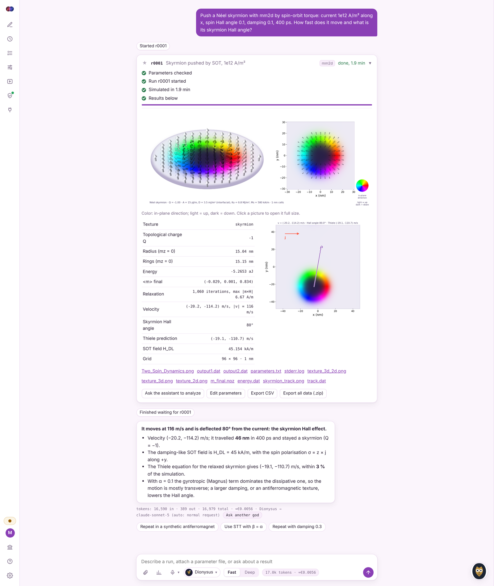

- **Antiferromagnetic skyrmions.** `lattice=saf` is a synthetic antiferromagnet: two ferromagnetic layers coupled
  antiparallel through a spacer (RKKY, `J_rkky` < 0), each with its own thin-film field, as in Pt/Co/Ru
  multilayers where such skyrmions are observed. `lattice=afm` is an intrinsic, compensated antiferromagnet with two
  sublattices coupled by `J_afm`. The two skyrmions have opposite charges, so their Magnus forces cancel: under the
  same current a synthetic-AFM skyrmion moves straight along the current, about six times faster than in a single
  layer. The pictures show the Néel vector with the arrows of the two layers (m1 red, m2 blue).

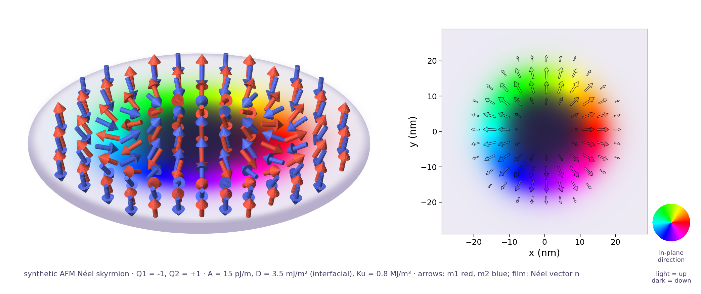

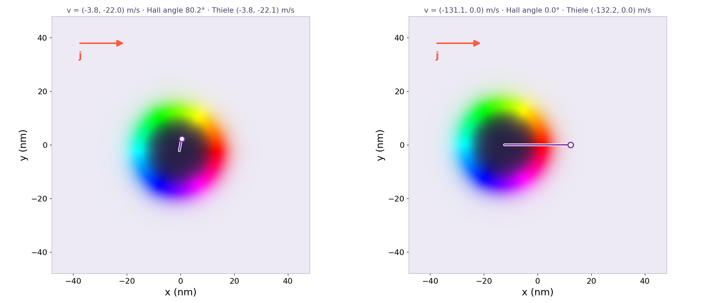

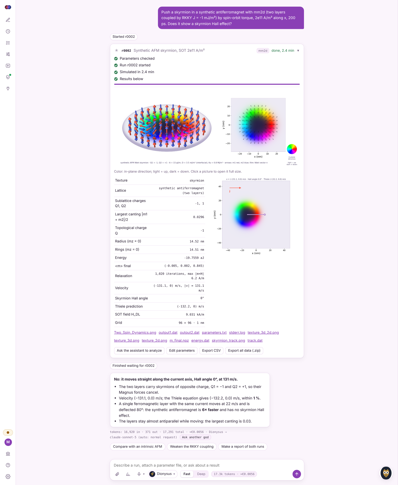

- **Spin waves.** `excite=stripe` or `dot` puts the field pulse on an antenna; `pulse=sine` at `f_rf` gives
  a monochromatic wave and its wavelength, `pulse=sinc` up to `f_rf` gives the whole dispersion f(k); `absorb`
  makes the edges absorbing. The run card shows the wave with the same 3D arrows (colour = phase of the
  precession) and the line profile or the dispersion with the analytic curve.

```text
--mode=dynamics
--texture=uniform
--Nx=300
--Ny=100
--dx=2e-9
--excite=stripe
--excite_x=-150e-9
--pulse=sine
--f_rf=80e9
--B_pulse=0.02,0,0
--t_pulse=300e-12
--t=300e-12
--table_dt=2e-12
--absorb=100e-9
```

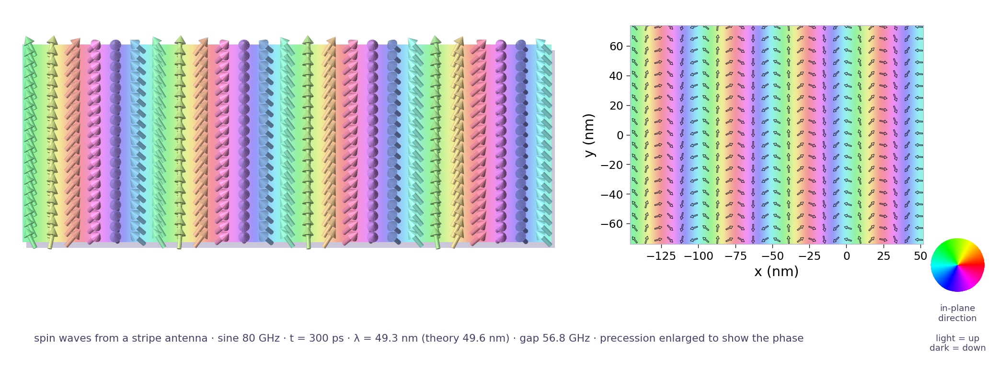
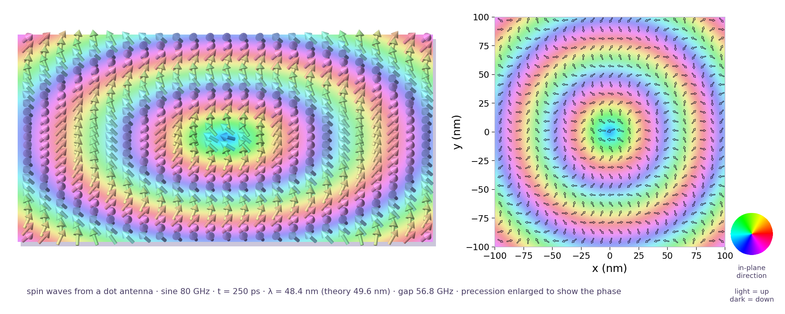
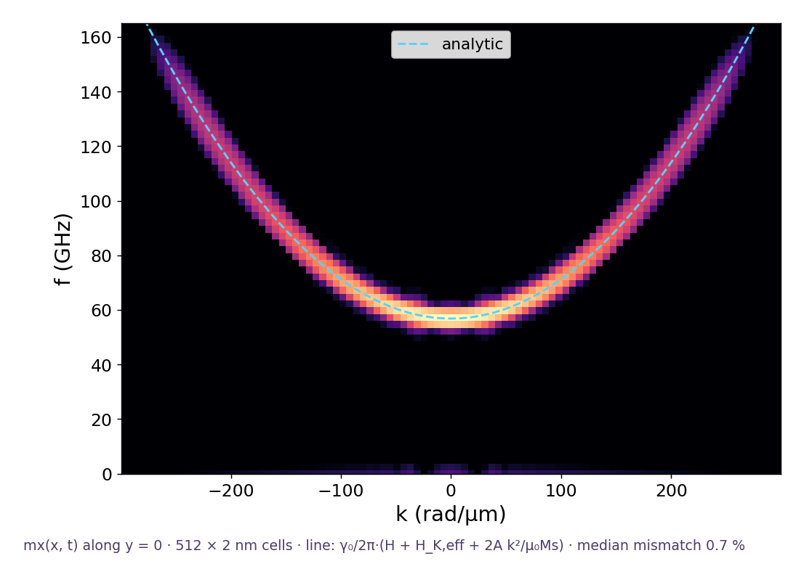

- **Validated** in `tests/test_mm2d.py` against analytic results: wall energy 4√(A·Keff) − π|D| and width
  √(A/Keff) for both DMI types, the Kittel frequency, energy conservation without damping, |m| = 1, and
  Q = −1 for a skyrmion and 0 for skyrmionium, and for spin waves the wavelength at 80 GHz (49.3 nm against
  49.6 nm) the dispersion f(k) (within 1 %), and for currents the Thiele equation: v = u for STT with β = α (within
  1 %), the velocity under STT with β ≠ α and under SOT, and for antiferromagnets the static profile against a
  ferromagnet without demag and the absence of a skyrmion Hall effect.
- **Limits.** One cell thick; the demagnetising field is local (−Ms·mz), so there is no long-range stray field.
  A 128 × 128 relaxation takes a few seconds. Two sublattices and a GPU version are planned.

Choose **mm2d** in the Engine menu of Run setup, or ask for a skyrmion in the chat. Agents call
`list_engines` and pass `engine="mm2d"`.

In the chat it works like the other tools: ask in plain language, the assistant picks mm2d, runs it and reads
the result from the run card.

<table>
<tr>
<td width="50%">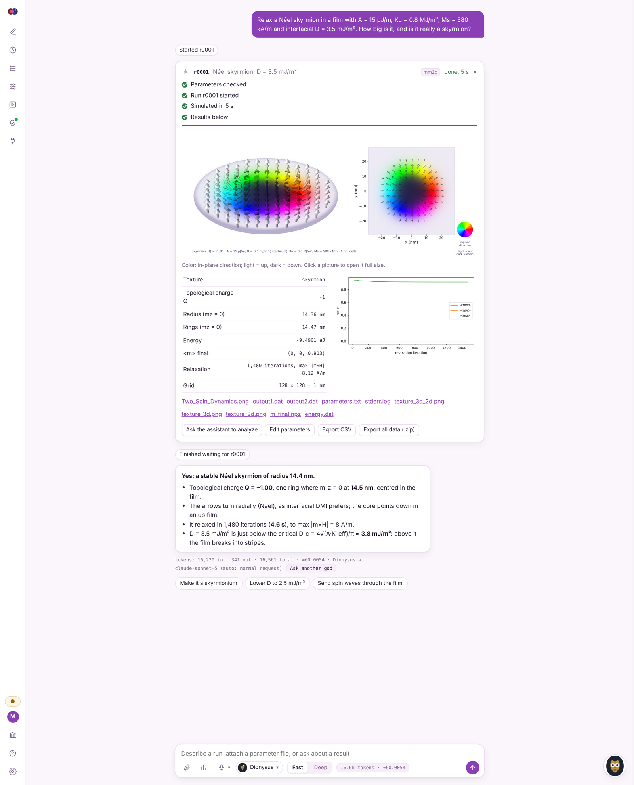</td>
<td width="50%">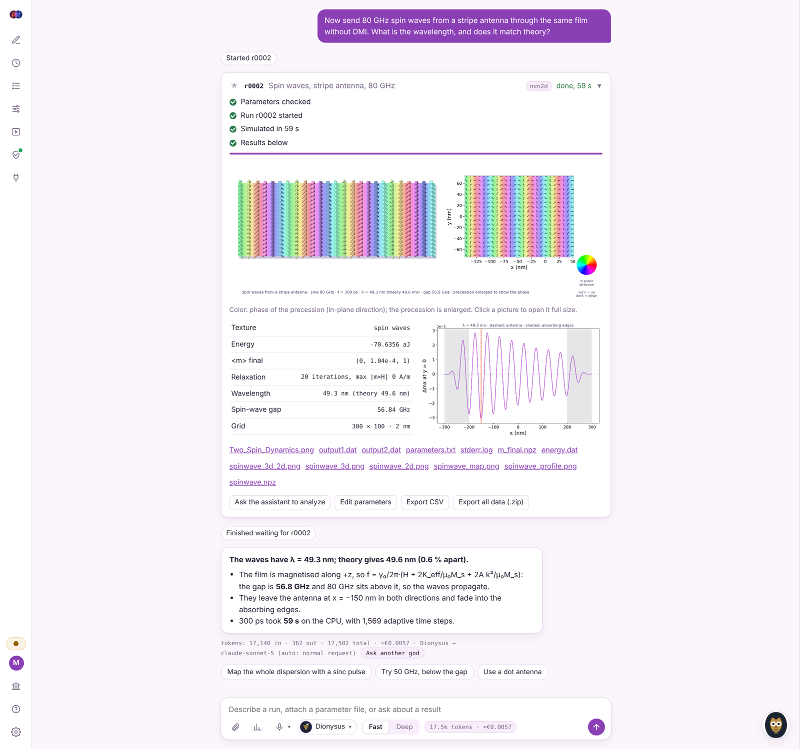</td>
</tr>
<tr><td align="center"><i>A skyrmion from a question</i></td><td align="center"><i>Spin waves from a question</i></td></tr>
</table>

### mm3d engine: 3D micromagnetics and hopfions (built in)

`spinmate_core/mm3d` extends the solver to three dimensions: a chiral magnet slab or nanodisk with exchange,
bulk or interfacial DMI, anisotropy and field, the top and bottom surfaces pinned along +z. It relaxes hopfions
and skyrmion tubes and computes the Hopf index H from the emergent field (with an FFT for its vector potential).

```text
--texture=hopfion
--Aex=10e-12
--D=5.236e-3
--Nz=24
--geometry=disk
--disk_diameter=54e-9
--B_ext=0,0,0.3
```

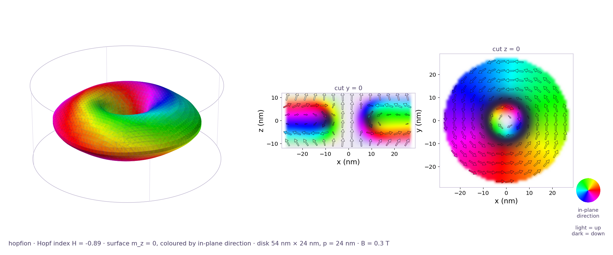

- **What binds it.** A disk about 2p across and about p thick, p = 4πA/D the helical period, with the surfaces
  pinned up (strong surface anisotropy), at 0 to 0.3 T. In a periodic slab the hopfion unwinds or grows into
  helices, and the engine warns about it.
- **Results.** The card shows the m_z = 0 torus in 3D (colour = in-plane direction; it turns once around the
  ring) and the cuts y = 0 and z = 0, with H, the core ring radius and the rings where m_z = 0. The default
  hopfion relaxes in about a minute with H = −0.89 on the grid (|H| = 1).
- **Validated** in `tests/test_mm3d.py`: the energy of a helix with q = D/2A against −D²/4A, the same fields as
  mm2d in one layer, the Hopf index of the seed, and a hopfion that keeps |H| > 0.7 through the relaxation.
- **Limits.** No demagnetising field; CPU only, so a few hundred thousand cells at most.

<table>
<tr>
<td width="50%">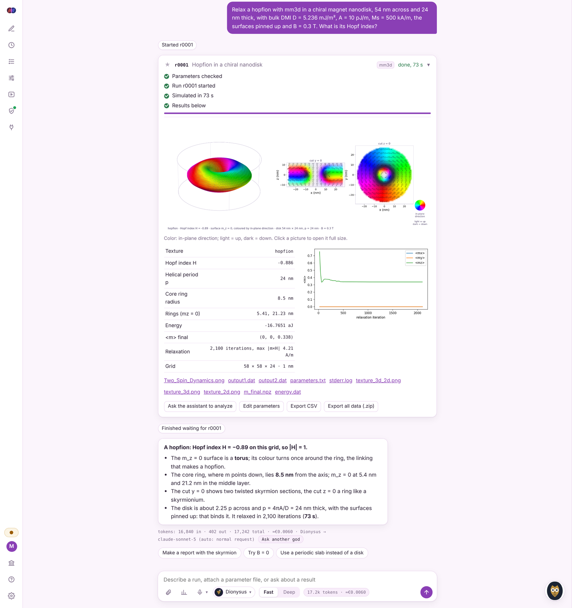</td>
<td width="50%">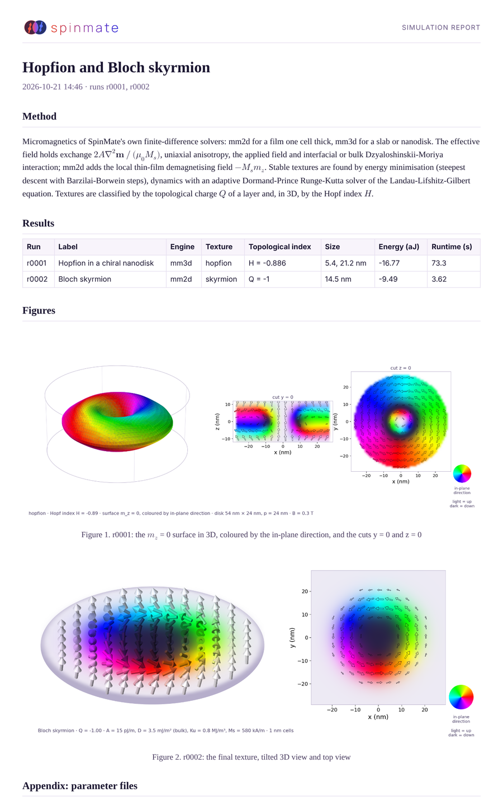</td>
</tr>
<tr><td align="center"><i>A hopfion from a question</i></td><td align="center"><i>Reports include the texture pictures</i></td></tr>
</table>

### mumax3 engine (optional plug-in)

`plugins/spinmate-mumax3` adds [mumax3](https://mumax.github.io) (GPU micromagnetics) as an optional third engine,
through the same interface as macrospin. The input is either SpinMate lines, turned into an `.mx3` script,

```text
--Nx=128
--Ny=128
--Msat=800e3
--Aex=13e-12
--alpha=0.02
--B_ext=0,0,0.1
--t=2e-9
```

or a complete `.mx3` script. The run card, exports and figures show the average magnetisation ⟨m⟩(t); the
script and the mumax3 table are kept in the run folder. Agents call `list_engines` and pass `engine="mumax3"`.

The Docker image installs the plug-in. mumax3 itself needs an NVIDIA GPU: install it from the mumax3 releases
and set `MUMAX3_BIN` to the binary (in Docker, add the GPU to the service with the NVIDIA Container Toolkit).
Without it, `validate_parameters` warns and the run fails with "mumax3 not found". Outside Docker:

```bash
pip install -e plugins/spinmate-mumax3
```

mumax3 is free software under the GNU GPL v3 (with a CUDA exception); SpinMate only starts it as a separate
program and stays under the MIT License. If you publish results obtained with mumax3, cite Vansteenkiste et
al., *The design and verification of MuMax3*, AIP Advances 4, 107133 (2014). The mumax3 name and logo belong
to its authors. Details in `plugins/spinmate-mumax3/README.md`.

Development happens on the `development` branch, one feature branch per step: the MCP server first, then
`spinmate-core` and the engine interface, the physics validation suite, the physics subagent, the web app as
an MCP client, a second engine (mumax3), SpinMate's own 2D and 3D micromagnetics (mm2d, mm3d), Gemini as a third model provider and the 2.0 controls of the page
(engine menu, validation badge, connect dialog, key check), then usage and cost per provider, the admin page,
*Ask another god* and the sweep/threshold form. `main` keeps the stable 1.x release.

## Admin page

`/admin` is off unless you set `ADMIN_TOKEN` in `.env` (a long random value:
`python -c "import secrets; print(secrets.token_urlsafe(24))"`). With it, the page asks for the token and shows
the accounts of this server, which welcome emails were sent and when, the outbox and the cost per day and
provider, and can delete an account on request. It shows only the server it runs on.

Sign-ups from every SpinMate install are written by the mail relay to the **SpinMate users** Google Sheet of the
relay's account (see `relay/README.md`); only that account can open it. Put its link in `ADMIN_SHEET_URL` to show
it on the admin page. Athena tells people at sign-up that their email is kept and how to have it deleted.

## Prompt evaluation

`evals/` runs a fixed set of requests (`evals/cases.py`: the starter scenarios, a 100 ps run, FeRh in Deep mode,
SOT rotation, a unit slip, a continuation, a goal search, two catalog questions, a parameter question and a
two-message greeting check) through the real agent and real simulations, and checks the tools used, the final
order, the answer length and what the answer says. It uses a temporary workspace, so your runs are not touched.

```bash
docker compose exec -e ANTHROPIC_API_KEY=sk-... sublattice-agent python -m evals.run_eval --label v2
docker compose exec -e ANTHROPIC_API_KEY=sk-... sublattice-agent python -m evals.run_eval --label v1 --prompt v1
docker compose exec sublattice-agent python -m evals.run_eval --compare evals/results/v1.json evals/results/v2.json
docker compose cp sublattice-agent:/app/evals/results ./evals/
```

`--prompt v1` uses the previous prompt (`evals/prompt_v1.py`), `--cases a,b` runs only some cases and
`--model` picks the model. Each report (`evals/results/<label>.md`) lists, per case, the checks, model calls,
tokens, answer lines, the tool sequence and the answer.

## Development

```bash
pip install -r requirements-dev.txt
pytest -q
```

```
app/               web server, agent loop (Claude, OpenAI, Gemini), model router, MCP client, prompts, guide
spinmate_core/     the engine without an LLM: tools, run queue, runner, the mm2d and mm3d solvers, catalog, figures, reports, validation
spinmate_mcp/      the MCP server and the physics guide (physics.md)
plugins/           optional engines (spinmate-mumax3)
macrospin/         the simulation code (four fixes in 2.0, see Physics validation)
original_scripts/  original batch scripts (prepare, run_sim, avg_neel, neel_vector_generate)
web/               the interface (index.html) and its translations (i18n.js)
docs/              user guide, presentation, architecture diagrams, validation report
examples/          parameter files
tests/             unit, API, MCP, engine and physics tests
evals/             prompt evaluation with the real agent
```

The server has no login. It is meant for local use; do not expose the port to the internet, since anyone
who can reach it can start simulations and use the server-side API keys.

## Security

SpinMate is meant to run on your own computer.

- **Local only by default.** Docker publishes the app on `127.0.0.1`. There is no password (the name you
  give Athena is not a login), so anyone who can reach the page can run simulations and spend your API
  key. Set `BIND_ADDRESS=0.0.0.0` only behind a reverse proxy with real authentication. The MCP endpoint
  (`/mcp`) is on the same port and follows the same rule.
- **Limit the cost.** Set `TOKEN_BUDGET` in `.env` and a monthly spend limit in the Anthropic, OpenAI and Google
  consoles. Use a separate API key for SpinMate so you can revoke it on its own.
- **Change `POSTGRES_PASSWORD`.** The database is not exposed outside Docker, but the default is public.
- **Keys** stay in `.env` (ignored by git) or in the browser tab where you paste them.
- The agent can only read the run catalog (read-only SQL with a timeout) and only start runs through the
  solver's own parameter parser; uploads are limited to 200 kB of text.

## Contact

Questions, ideas or bug reports: [spinmate.ai.agent@gmail.com](mailto:spinmate.ai.agent@gmail.com).
You can also open an issue on [GitHub](https://github.com/Michaellianeris/Spinmate-AI-Agent/issues).

## License

SpinMate is free and open source under the [MIT License](LICENSE): anyone may use, copy, modify and
share it, for research, teaching or commercial work, as long as the copyright notice is kept. It comes
without warranty. If you use it in published work, a mention of SpinMate is appreciated.

The API keys you add are yours; calls to Anthropic, OpenAI or Google are billed to your own account.
